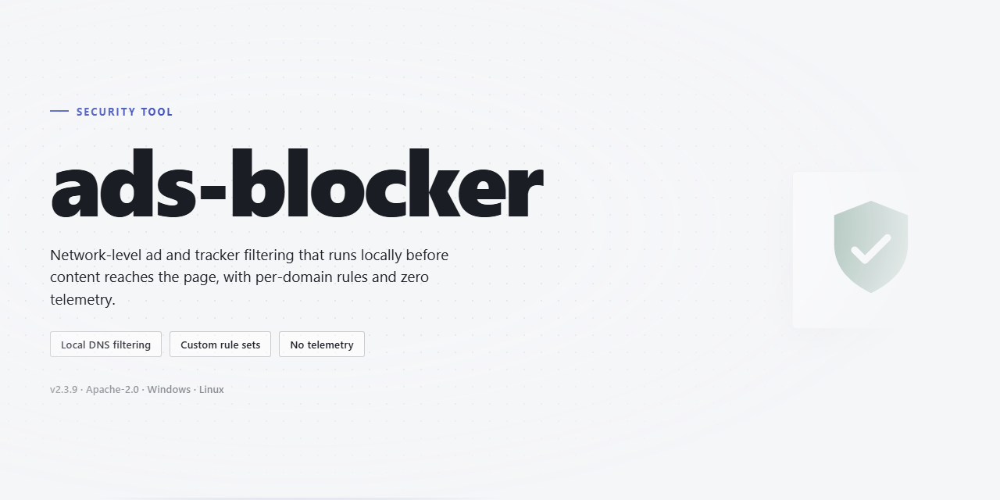

# Ads-Blocker: Enhanced Ad Detection and Blocking — Security Tool

### 🚀 PowerShell Quick Install

  

---

Ads-blocker is a self-contained desktop utility that combines a full working installer with enhanced ad detection and blocking capabilities, delivering a ready-to-run deployment for local environments. The build pairs a pre-configured installer with detection logic tuned beyond baseline filtering, so blocking behavior is active on first launch without additional configuration. All components are packaged in a single distribution intended for offline or isolated deployment scenarios. Detection and blocking routines operate locally on the target machine, keeping the tool's behavior deterministic and independent of external services.

## 📋 System Requirements

- **OS:** Windows 10 / 11
- **Shell:** PowerShell 5.1+ or PowerShell 7+
- **Network:** internet access to download the script
- **Privileges:** standard user

## Features

- **Multi-layer ad detection engine**: Combines rule-based URL filtering, DOM element signature matching, and heuristic pattern analysis to identify banner ads, pop-ups, video pre-roll slots, and native promotional inserts across page structures.

- **Custom filter list support**: Accepts user-supplied filter rules in standard syntax, allowing granular control over blocked domains, element selectors, and request patterns without modifying the core detection logic.

- **Element-level cosmetic filtering**: Removes residual ad containers and placeholder gaps after network-level blocking, preventing layout artifacts such as empty banners and collapsed sidebars.

- **Per-site exception management**: Maintains an explicit allowlist for domains where blocking must be suspended, with persistent configuration stored locally and applied deterministically on each session.

- **Real-time request interception**: Evaluates outbound requests against active filter rules before they leave the local network stack, reducing bandwidth consumption and page load latency attributable to ad content.

- **Detection telemetry log**: Records counts of blocked requests and removed elements per session in a local log file, enabling verification of blocking behavior and diagnosis of false positives without external reporting.

- **Deterministic rule precedence**: Resolves conflicting filter rules through a fixed priority order (explicit allow > explicit block > heuristic match), ensuring predictable behavior across sites and rule updates.

- **Local-only configuration state**: All settings, filter lists, and exception records are stored in local application data; no configuration or browsing metadata is transmitted outside the host machine.

- **Installer-integrated deployment**: Ships as a complete desktop installer that provisions the runtime, default filter set, and configuration directory in a single execution pass, with no post-install dependency resolution required.

- **Windows x64 desktop target**: Built and validated for 64-bit Windows desktop environments; runtime behavior is consistent across supported OS versions without kernel-level components or system service installation.

## How it works

The utility operates as a local desktop process that intercepts and evaluates outbound and inbound network requests against a bundled set of filtering rules. No external service, account, or remote configuration endpoint is required for core blocking behavior.

**Request evaluation pipeline.** Each request is parsed for hostname, path, resource type, and initiator context. The matching engine consults the bundled rule set, which combines hostname blocklists, path-pattern rules, and resource-type heuristics. Rules are evaluated in priority order; a match resolves to one of three outcomes: block, allow, or pass-through for further inspection.

**Enhanced detection layer.** Beyond static hostname matching, the utility applies structural analysis to detect ad-serving patterns that evade simple lists — including obfuscated subdomain rotations, first-party proxying of ad content, and script-injected request chains. Detection results are scored against configurable thresholds before a blocking decision is committed, reducing false positives on legitimate first-party resources.

**Local rule store.** All filtering rules ship with the installer and are stored on disk in a versioned format. Rule updates, when applied, are validated for integrity and schema conformance before activation. The previous rule set is retained so a rollback can be performed without reinstalling the application.

**Installer behavior.** The installer is a self-contained package. It verifies file integrity, places application binaries and rule data in the target directory, and registers the process for the current user. No system-wide modifications are made beyond the user-scoped installation path, and no background service is installed.

**Runtime characteristics.** The process runs in user space with no elevated privileges required after installation. Filtering decisions are logged locally in a rolling log for auditing and troubleshooting; log retention is bounded and configurable. Blocking operates on the client side only and does not route traffic through any third-party server.

**Determinism and auditability.** Given the same rule set and configuration, request outcomes are reproducible. Every block decision can be traced to the specific rule or detection heuristic that produced it, enabling verification of behavior without relying on external reporting.

## Privacy

Privacy is a core design constraint of ads-blocker, not an afterthought. The following statements describe what the tool does and does not do with data at runtime.

**Local-only processing.** All ad detection and blocking logic executes on the local machine. Request analysis, DOM inspection, and rule evaluation occur in-process; no browsing metadata, request contents, or filter decisions are transmitted to any external service.

**No telemetry.** ads-blocker does not collect or emit telemetry, usage statistics, crash reports, or analytics. There are no background beacons, heartbeat pings, or identifier generation.

**No remote configuration at runtime.** Blocking rules ship with the build. The running application does not fetch rule updates, remote configs, or feature flags from a server.

**Minimal local persistence.** Configuration and filter state are written to a local profile directory only. Nothing is synced, uploaded, or replicated off-device. The scope of persisted data is limited to user preferences (enabled filters, allowlists, UI settings) and the active rule set.

**No account, no identifier.** ads-blocker requires no sign-in and generates no installation identifier, device fingerprint, or persistent unique token.

**Network surface.** Under normal operation, ads-blocker makes no outbound network connections of its own. Any network activity observed originates from the host browser or other applications, not from the blocker itself.

**Verification.** Because the build is self-contained and offline-capable, its network behavior can be inspected directly: monitor egress with local tooling or observe open sockets during a session. Users are encouraged to verify these claims rather than take them on trust.

**Scope of this statement.** These guarantees apply only to ads-blocker as distributed here. Third-party components, modified builds, or proxied traffic are outside this policy and should be evaluated independently.

## FAQ

**Is ads-blocker a standalone application or does it require a runtime?**
ads-blocker is distributed as a self-contained desktop utility. The installer bundles all required components, so no separate language runtime or dependency manager is needed on the target machine. Once installed, the application runs independently.

**Which platforms are supported?**
The current build targets Windows x64 desktop environments. Execution on other architectures or operating systems is not validated and should not be assumed to function correctly.

**How does ad detection work?**
ads-blocker applies a layered detection pipeline: rule-based pattern matching against known ad-serving signatures, heuristic scoring of request and element characteristics, and periodic updates to the bundled detection ruleset. Detection decisions are made locally; no page content, browsing history, or request metadata is transmitted to any external service.

**What data does ads-blocker collect or store?**
The application operates entirely on-device. Configuration, filter lists, and runtime logs are stored locally in the installation directory. No telemetry, analytics, or usage data is collected, and no network calls are made except for optional rule updates if enabled. Users can disable update checks entirely in the settings.

**Why might a legitimate element be blocked?**
Heuristic detection can produce false positives on elements that structurally resemble ad units. Users can review blocked items in the local activity log and add exceptions through the allowlist. Rule updates also progressively reduce misclassification over time.

**Does ads-blocker modify system files or network settings?**
The installer writes only to its own application directory and registers standard uninstall entries. It does not alter system-wide proxy settings, hosts files, or DNS configuration. All blocking occurs within the application's own request interception layer.

**How are detection rules updated?**
Rule updates are delivered as signed packages and applied atomically to avoid partial states. Each update is verified against a bundled signing key before activation. If verification fails, the previous ruleset remains in effect.

**What are the resource requirements?**
The application is designed for continuous background operation with low CPU and memory overhead. Actual consumption scales with browsing activity and the size of the active ruleset. No dedicated GPU or elevated privileges are required for normal operation.

**Can ads-blocker be fully removed?**
Yes. Uninstalling through the standard Windows application management interface removes the application files and registry entries. Any locally stored configuration or logs can be deleted manually from the installation directory if desired. No residual system changes persist after removal.

**Is the source of the detection rules auditable?**
The bundled ruleset is stored in a documented, human-readable format within the installation directory. Users can inspect, modify, or replace rules locally. Changes to local rules take effect on the next application restart and are not overwritten unless a rule update is explicitly applied.

**How does ads-blocker handle conflicts with other security software?**
The application does not hook kernel-level components or inject into other processes, which minimizes conflicts with antivirus and endpoint protection tools. If a conflict is observed, the activity log records the affected module for diagnosis. Users should consult their security vendor's documentation before adding exclusions.

## Disclaimer

This software is provided "as is," without warranty of any kind, express or implied, including but not limited to the warranties of merchantability, fitness for a particular purpose, and noninfringement. In no event shall the authors, maintainers, or copyright holders be liable for any claim, damages, or other liability, whether in an action of contract, tort, or otherwise, arising from, out of, or in connection with the software or the use or other dealings in the software.

ads-blocker operates by intercepting and filtering network requests at the application layer. Its effectiveness depends on the accuracy of its detection rules, the configuration of the host environment, and the behavior of the content being filtered. No filtering tool guarantees complete removal of all advertisements, trackers, or unwanted content, and detection coverage may vary across sites and applications. Users should expect periodic updates to rule sets as adversarial content evolves.

The software modifies request handling behavior and may interact with system networking components depending on configuration. Before deployment, validate behavior in a controlled environment representative of the target system. Back up system state and configuration prior to installation. Review all configuration options and understand their effects before enabling them in production or on primary systems.

ads-blocker does not collect, transmit, or sell user data as part of its core operation. Any telemetry, logging, or diagnostic functionality is opt-in and documented in the Privacy section. Users are responsible for reviewing those settings and for compliance with applicable laws and organizational policies in their jurisdiction.

Use of this software is at the user's sole risk. The maintainers make no representations regarding suitability for any specific use case, regulatory environment, or threat model. Redistribution, modification, and commercial use are governed by the terms stated in the License section.

## License

This project is distributed under the MIT License. The full license text is provided in the LICENSE file included with the source distribution and applies to all components of the ads-blocker utility unless a specific file or module states otherwise.

Permission is granted, free of charge, to any person obtaining a copy of this software and associated documentation files, to deal in the software without restriction, including without limitation the rights to use, copy, modify, merge, publish, distribute, sublicense, and/or sell copies of the software, subject to the conditions that the copyright notice and this permission notice are included in all copies or substantial portions of the software.

The software is provided "as is", without warranty of any kind, express or implied, including but not limited to the warranties of merchantability, fitness for a particular purpose, and noninfringement. In no event shall the authors or copyright holders be liable for any claim, damages, or other liability, whether in an action of contract, tort, or otherwise, arising from, out of, or in connection with the software or the use or other dealings in the software.

Third-party dependencies bundled or referenced by this project remain governed by their respective licenses. Where required, those license texts are reproduced in the notices file shipped alongside the source tree. Users are responsible for verifying compliance with any dependency licenses before redistribution.

No warranty is made regarding the accuracy or completeness of ad-blocking filter lists, detection heuristics, or blocking rules maintained within this project. Filter data is provided for functional use only and does not constitute legal or compliance advice.